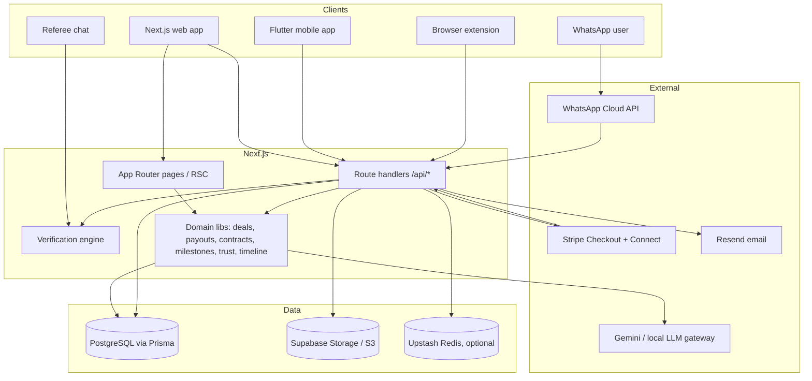
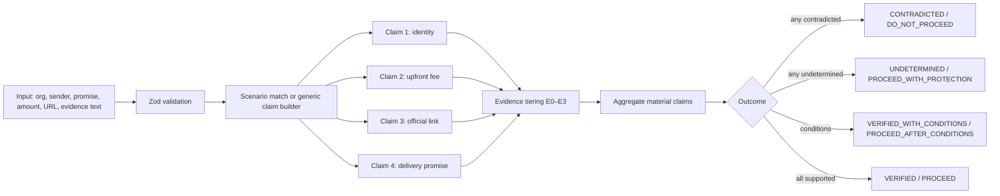
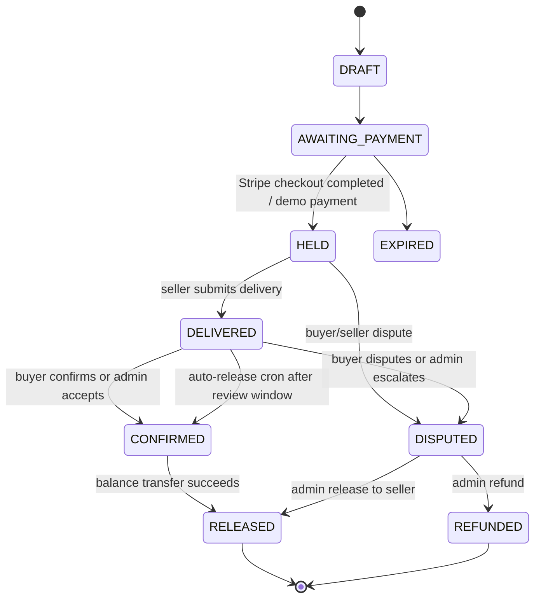
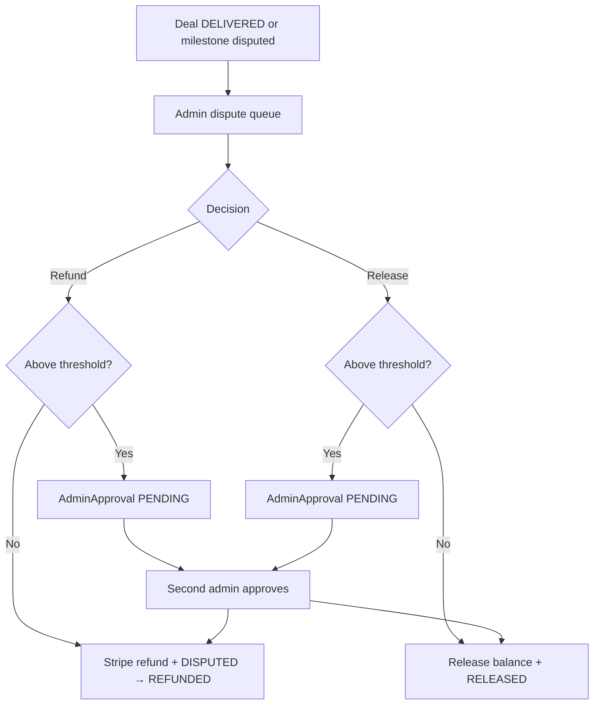

# TrustBridge — Full Project Documentation

> **Verify the claim before you pay.**
> TrustBridge is a verification-and-protected-payment platform for deals made in chat, email, and job boards.

- **Repository:** `AbhijitK20/trustbridge` (branch `main`)
- **Web app:** Next.js 16 App Router
- **Mobile app:** Flutter (Android APK built in CI)
- **Browser extension:** Manifest V3 content script
- **Production URL used in code:** `https://trustbridge-abhithe.vercel.app`
- **License / status:** hackathon project, demo-capable, partially production-hardened

---

## 1. What it is

TrustBridge attacks a single failure mode: **people send money to someone they met online before they have any independent reason to trust them.**

It does two things:

1. **Verification** — turns an offer, message, email, or link into a list of *claims*, weighs each claim against evidence tiers, and returns one of four honest outcomes instead of a fake "safe/unsafe" binary.
2. **Protected payments** — records the deal as a public link, holds the buyer's money through Stripe, releases the deposit on delivery, releases the balance on buyer acceptance (or auto-release after a 7-day review window), and routes any disagreement through a human admin with an audit trail.

The tagline in the UI: *"Verify first. Protect the deal. Evidence tiers, protected payments and human-first disputes for work found in chat."*

---

## 2. Feature map

| Area | What it does |
|---|---|
| **Verification engine** | Deterministic, rule-based claim/evidence analysis. Four outcomes, four decisions, evidence tiers E0–E3, per-claim rationale, conditions, and "could not determine" lists. |
| **Four verdicts** | `VERIFIED`, `VERIFIED_WITH_CONDITIONS`, `CONTRADICTED`, `UNDETERMINED` → decisions `PROCEED`, `PROCEED_AFTER_CONDITIONS`, `PROCEED_WITH_PROTECTION`, `DO_NOT_PROCEED`. |
| **Evidence tiers** | E0 self-asserted screenshot, E1 platform-asserted account, E2 derived/indirect, E3 independent first-party source. Timing: `BEFORE` / `DURING` / `AFTER`; relation: `SUPPORTS` / `CONTRADICTS` / `NEUTRAL`. |
| **Scenarios** | Preset walkthroughs: fake Google internship, official page check, verified recruiter, unknown seller. |
| **Referee chat** | Client-side conversational wrapper around the same engine that drafts a reply the user can send. |
| **WhatsApp bot** | Meta Cloud API webhook + local simulator. Same engine, returns a WhatsApp-formatted verdict with a report link. |
| **Browser extension** | MV3 content script injected on every page; sends page text to `/api/check` and renders a Shadow DOM verification panel. |
| **Protected deals** | Public tokenised deal link, deposit/balance split, deadline, shared timeline, evidence upload, signed PDF contract. |
| **Milestones** | Up to 8 per deal, amounts must sum to the total, per-milestone acceptance criteria, buyer accept / request changes / dispute, optional verification gating. |
| **Contracts** | Deterministic snapshot, SHA-256 content hash, typed e-signature for buyer and seller, generated PDF (`pdf-lib`). |
| **Payment rail** | Stripe Checkout for collection, Stripe Connect Express transfers for payout, idempotent transfers, platform fee. Full demo ledger mode without Stripe. |
| **Disputes** | Buyer/seller statements, admin queue, refund / release decisions, maker-checker second approval above a configurable threshold. |
| **Seller KYC** | Work-email OTP + domain checks, legal name vs payout-name match, DigiLocker flag, sanctions status, admin compliance queue. |
| **Trust score** | 0–100 score from completed deals, ratings, refund disputes, and open reports. |
| **Seller profiles** | Public `/seller/[slug]`, ratings, scam reports, trust badge, verification method. |
| **Admin console** | Dispute queue, delivery review, approval queue, compliance/KYC queue, report queue. |
| **User workspace** | `/app` dashboard (home, check, deals, profile) with a mobile-style bottom nav. |
| **Legal surface** | Terms, privacy, refunds, acceptable use, cookies, seller agreement, grievance — versioned in code. |
| **Mobile client** | Flutter app with login, home, check, deals, deal detail, milestones, contract card, credits/ledger. |
| **Ops** | `/api/health`, daily auto-release cron, structured audit log, webhook idempotency table, rate limiting, security headers. |

---

## 3. Tech stack

| Layer | Technology |
|---|---|
| Framework | Next.js `16.3.4` (App Router, Server Components, route handlers) |
| UI | React `19.2.8`, Tailwind CSS v4, custom CSS design system |
| Language | TypeScript 5, strict mode |
| ORM / DB | Prisma `6.x` + PostgreSQL (Supabase / Neon / local Docker) |
| Auth | Auth.js / NextAuth `5.0.0-beta.32` + `@auth/prisma-adapter`, Google OAuth (optional), database sessions |
| Payments | Stripe `22.x` (Checkout + Connect Express + Transfers + Refunds) |
| AI review | Google Generative AI (`@google/generative-ai`, Gemini) with fallback to a local OpenAI-compatible gateway |
| Storage | Supabase Storage (service role) **or** S3-compatible (Cloudflare R2 / AWS S3) signed URLs |
| Rate limiting | In-memory buckets + optional Upstash Redis sliding window |
| Motion / 3D | `motion`, `lenis`, `@react-three/fiber`, `@react-three/drei`, `three` |
| PDF | `pdf-lib` |
| Validation | `zod` 4 |
| Email | Resend (OTP for seller verification) |
| Messaging | WhatsApp Cloud API (Meta) |
| Mobile | Flutter 3.4+, Dart, `http`, `shared_preferences`, `url_launcher`, `intl` |
| Extension | Chrome Manifest V3, vanilla JS, Shadow DOM |
| Tests | Vitest 3 |
| CI/CD | GitHub Actions (Node 24 + Postgres 16), Vercel, Flutter APK workflow |
| Container | Multi-stage Dockerfile (Node 24 Alpine, `output: "standalone"`) |

---

## 4. High-level architecture



### Runtime shape

- Server-rendered pages read directly through Prisma (no separate backend).
- Mutations go through `POST` route handlers with Zod validation, same-origin checks, and per-IP rate limits.
- Payment state is reconciled by signed webhooks (`/api/stripe/webhook`, `/api/razorpay/webhook`) and a daily cron.
- Every material state change writes an `AuditLog` row; the deal timeline is derived from audit logs + evidence + disputes + consents.

---

## 5. Repository map

```
.
├── .github/workflows/
│   ├── ci.yml                  # typegen, typecheck, lint, test, build (Postgres 16 service)
│   └── flutter-apk.yml         # scaffold Android shell, build release APK
├── prisma/
│   ├── schema.prisma           # 20 models, 13 enums
│   └── migrations/             # 7 migrations (init → legal/KYC → hashes → approvals → WhatsApp → milestones/contracts → emailVerified)
├── public/
│   └── extension/              # manifest.json, config.js, content.js (MV3 demo extension)
├── src/
│   ├── auth.ts                 # Auth.js config, ADMIN_EMAILS promotion
│   ├── app/
│   │   ├── page.tsx            # marketing landing
│   │   ├── check/              # public verification form + report
│   │   ├── create/             # deal creation + milestone editor
│   │   ├── deal/[token]/       # public deal page, contract, receipt, milestones, dispute
│   │   ├── verification/[id]/  # saved verification report
│   │   ├── referee/            # chat-style referee
│   │   ├── demo/               # scam page + WhatsApp simulator
│   │   ├── seller/[slug]/      # public seller profile + ratings/reports
│   │   ├── seller/verify/      # KYC / work-email verification
│   │   ├── app/                # signed-in workspace (home, check, deals, profile)
│   │   ├── admin/              # disputes, deliveries, approvals, compliance, reports
│   │   ├── onboarding/         # Stripe Connect return / refresh / start
│   │   ├── legal/[slug]/       # versioned legal pages
│   │   ├── signin/             # sign-in + server action
│   │   └── api/                # all route handlers (see §9)
│   ├── components/
│   │   ├── landing/            # nav, hero, vault-scene, sections, footer
│   │   ├── experience/         # Lenis smooth scroll, cursor, page transitions, UI primitives
│   │   └── legal-footer.tsx
│   ├── lib/
│   │   ├── verification/       # engine, scenarios, schema, types, tests
│   │   ├── deals.ts            # public deal query + payment eligibility
│   │   ├── payouts.ts          # fee split, deposit/balance transfers, idempotency
│   │   ├── contracts.ts        # snapshot, hash, signing lifecycle
│   │   ├── contract-pdf.ts     # PDF renderer
│   │   ├── milestones.ts       # draft validation + progress
│   │   ├── approvals.ts        # maker-checker threshold
│   │   ├── admin-decisions.ts  # refund/release execution
│   │   ├── trust.ts            # trust score formula
│   │   ├── timeline.ts         # audit → human timeline
│   │   ├── ai-review.ts        # Gemini evidence review with fallback chain
│   │   ├── whatsapp.ts         # message parsing + reply formatting
│   │   ├── demo.ts             # demo workspace seeding + session
│   │   ├── storage.ts          # signed upload/download URLs
│   │   ├── stripe.ts           # client + platform fee
│   │   ├── abuse.ts            # origin checks + rate limits
│   │   ├── legal.ts / legal-content.ts
│   │   ├── mobile.ts           # mobile serializers + stats
│   │   └── hash.ts / time.ts / env.ts / prisma.ts
│   └── types/next-auth.d.ts
├── mobile/
│   ├── lib/main.dart           # app entry
│   ├── lib/api.dart            # HTTP client + persisted demo session
│   ├── lib/screens.dart        # login, shell, home, check, deals, credits, deal detail
│   ├── lib/theme.dart          # TrustBridge design tokens for Flutter
│   └── scripts/patch_android.py
├── supabase/                   # local/link config (no secrets committed)
├── design/                     # exported design boards and screenshots
├── refs/                       # third-party reference repos (gitignored)
├── Dockerfile / docker-compose.yml
├── vercel.json                 # region hnd1 + daily cron
├── next.config.ts              # security headers / CSP
└── package.json
```

---

## 6. Data model

### 6.1 Models (Prisma, PostgreSQL)

| Model | Purpose | Key fields / relations |
|---|---|---|
| `User` | Auth + role | `email`, `role` (`BUYER`/`SELLER`/`ADMIN`), `emailVerified`, relations to deals, consents, approvals, signatures |
| `Account`, `Session`, `VerificationToken` | Auth.js adapter tables | OAuth accounts, database sessions, OTP token storage |
| `SellerProfile` | Public seller identity | `slug`, `bio`, `trustScore`, `averageRating`, `completedDeals`, `isVerified`, `verificationMethod`, `verificationDomain`, `stripeAccountId` |
| `Deal` | Core escrow record | `publicToken`, `title`, `description`, `priceCents`, `depositCents`, `balanceCents`, `status`, `currency`, `deliveryDeadline`, `autoReleaseAt`, Stripe IDs, `platformFeeCents`, buyer/seller/profile relations |
| `Evidence` | Delivery artifacts | `fileName`, `fileUrl`, `storageKey`, `mimeType`, `sha256`, `note`, AI verdict/confidence/reasoning |
| `Dispute` | Buyer/seller disagreement | `reason`, `resolution`, `decisionNote`, `decidedById`, `resolvedAt` |
| `Rating` | Post-release buyer rating | `score` 1–5, `comment`, unique per deal |
| `ScamReport` | Public seller report | `reason`, `status` (`OPEN`/`REVIEWING`/`RESOLVED`/`DISMISSED`) |
| `AuditLog` | Append-only event record | `action`, `metadata` JSON, optional deal/actor |
| `SellerKyc` | Compliance record | `legalName`, `entityType`, `taxIdLast4`, `kycStatus`, `sanctionsStatus`, payout bank/last4, verification timestamps |
| `Consent` | Versioned legal acceptance | `kind`, `version`, `acceptedAt`, IP, user agent |
| `VerificationCheck` | Saved verification report | `outcome`, `decision`, `organization`, `counterpartyEmail`, `promise`, `result` JSON |
| `AdminApproval` | Maker-checker request | `action`, `amountCents`, `note`, `status`, requester/decider |
| `Milestone` | Per-stage deliverable | `position`, title/description, `acceptanceCriteria`, `amountCents`, `status`, `verificationRequired`, submission/review notes |
| `Contract` | Deal agreement | `number`, `version`, `status`, `contentHash`, `snapshot` JSON |
| `ContractSignature` | Typed e-signature | `role`, `name`, `signatureText`, `method`, IP, user agent |
| `WhatsAppMessage` | Bot transcript | `waId`, `direction`, `body`, `reply` |
| `WebhookEvent` | Webhook idempotency | provider event ID + type + processed timestamp |

### 6.2 Enums

- `UserRole`: `BUYER`, `SELLER`, `ADMIN`
- `DealStatus`: `DRAFT`, `AWAITING_PAYMENT`, `HELD`, `DELIVERED`, `CONFIRMED`, `RELEASED`, `DISPUTED`, `REFUNDED`, `EXPIRED`
- `MilestoneStatus`: `PENDING`, `SUBMITTED`, `CHANGES_REQUESTED`, `RELEASED`, `DISPUTED`
- `ContractStatus`: `AWAITING_SIGNATURES`, `PARTIALLY_SIGNED`, `SIGNED`, `VOID`
- `ContractSignerRole`: `BUYER`, `SELLER`
- `DisputeResolution`: `RELEASE_TO_SELLER`, `REFUND_TO_BUYER`, `SPLIT_SETTLEMENT`
- `ReportStatus`: `OPEN`, `REVIEWING`, `RESOLVED`, `DISMISSED`
- `KycStatus`: `NOT_STARTED`, `PENDING`, `VERIFIED`, `REJECTED`, `EXPIRED`
- `SanctionsStatus`: `NOT_SCREENED`, `CLEAR`, `REVIEW`, `HIT`
- `SellerEntityType`: `INDIVIDUAL`, `SOLE_PROPRIETOR`, `PARTNERSHIP`, `LLP`, `COMPANY`
- `ConsentKind`: `TERMS`, `PRIVACY`, `SELLER_AGREEMENT`, `PAYOUT_AUTHORIZATION`, `ELECTRONIC_RECORDS`
- `ApprovalAction`: `DISPUTE_REFUND`, `DISPUTE_RELEASE`, `DELIVERY_ACCEPT`, `DELIVERY_REFUND`
- `ApprovalStatus`: `PENDING`, `APPROVED`, `REJECTED`, `EXECUTED`, `CANCELLED`

---

## 7. Core flows

### 7.1 Verification pipeline



Key rules in `src/lib/verification/engine.ts`:

- Known-organisation registry with official domains (Google, Microsoft, Amazon, Meta, Apple, Flipkart, Infosys, TCS, Wipro) and first-party policy facts.
- Sender-domain matching against official domains; Gmail/personal domains cannot establish authorisation.
- Upfront-fee detection (`registration fee`, `security deposit`, `processing fee`, amounts in ₹/Rs/INR/$) is contradicted by Google's published scam guidance when the organisation is known.
- Official-link verification checks both host and path prefix.
- Future delivery is always `UNDETERMINED` before performance.
- Aggregation is deterministic: a material contradiction always wins.

The engine is **rules-based, not LLM-based**. The Gemini integration is only used for *delivery evidence triage* (`src/lib/ai-review.ts`) and never decides money movement; its verdicts are `MATCHES`, `PARTIAL`, `DOES_NOT_MATCH`, `NEEDS_HUMAN_REVIEW`.

### 7.2 Deal lifecycle



- **Deposit** is released to the seller when delivery is submitted (`releaseDepositDeal`).
- **Balance** is released on buyer confirmation, admin acceptance, or the daily cron once `autoReleaseAt` passes (`releaseConfirmedDeal`).
- **Platform fee** defaults to 5% (`PLATFORM_FEE_PERCENT`), split proportionally between deposit and balance.
- Every release uses a deterministic Stripe idempotency key: `trustbridge-deposit-<dealId>`, `trustbridge-balance-<dealId>`, `trustbridge-refund-<dealId>`.

### 7.3 Milestones

1. Seller submits a milestone (`PENDING → SUBMITTED`), optionally with evidence.
2. Buyer can:
   - **Accept** → milestone `RELEASED`; when all milestones are released the deal becomes `RELEASED` and the balance is marked released.
   - **Request changes** → `CHANGES_REQUESTED`; seller can resubmit.
   - **Dispute** → milestone `DISPUTED` and deal `DISPUTED`.
3. Verification gating:
   - If `verificationRequired` and the linked check is `CONTRADICTED`, release is blocked.
   - If `UNDETERMINED`, the buyer must send `acknowledgeUnverified: true`.
4. Amount validation: max 8 milestones; every amount positive; sum must equal the deal total.

### 7.4 Contracts

- A deterministic snapshot is built from the deal (parties, KYC, milestones, evidence, verification, fees, terms).
- The snapshot (excluding `generatedAt`) is stable-stringified and SHA-256 hashed into `contentHash`.
- Buyer and seller each sign by typing a name/signature; IP and user agent are recorded.
- Status: `AWAITING_SIGNATURES → PARTIALLY_SIGNED → SIGNED`.
- `GET /api/deals/[token]/contract/pdf` renders a cached-free, no-store PDF.

### 7.5 Disputes and admin decisions



- Threshold defaults to **1,000,000 cents** (`ADMIN_APPROVAL_THRESHOLD_CENTS`).
- **Maker-checker:** the admin who requested a high-value decision cannot approve it.
- Delivery review actions: `ACCEPT`, `REFUND`, `DISPUTE` (escalate to dispute queue).
- Refund/release execution lives in `src/lib/admin-decisions.ts`; demo mode simulates without Stripe.

### 7.6 Seller KYC

1. `POST /api/sellers/otp` generates a 6-digit code, stores `${email}:${otp}` in `VerificationToken` (10-minute expiry), and emails it via Resend when configured.
2. `POST /api/sellers/otp/check` validates the code.
3. `POST /api/sellers/verify` requires:
   - work email on the claimed domain,
   - legal name,
   - entity type,
   - last 4 of tax ID,
   - payout account name/bank/last4,
   - OTP,
   - consent.
4. If the **legal name matches the payout account name**, KYC is `VERIFIED` and the profile is verified; otherwise `PENDING` for admin review.
5. Sanctions status is set to `CLEAR` by the self-serve flow; an admin can block approval if it is `HIT`.
6. Admin compliance queue can `APPROVE` or `REJECT` (rejection requires a note).
7. Accepting verification records consents: seller agreement, terms, privacy, payout authorization, electronic records.

### 7.7 Trust score

```
score =
  min(completedDeals * 2, 30)
  + (averageRating / 5) * 55
  + (hasRatings ? 15 : 0)
  - min(refundDisputes * 10, 25)
  - min(openReports * 15, 30)
```

Clamped to 0–100. Recalculated after ratings, report status changes, and refund/split disputes.

### 7.8 Delivery evidence AI triage

- Providers are tried in order from `AI_REVIEW_PROVIDERS` (default: Gemini flash variants, then a local gateway).
- The prompt forbids certainty from incomplete screenshots and forces `NEEDS_HUMAN_REVIEW` on ambiguity.
- Output is strict JSON, clamped confidence 0–100, persisted on the `Evidence` row.
- AI never releases funds; humans and the buyer do.

### 7.9 WhatsApp entry point

- `GET /api/whatsapp/webhook` handles Meta's `hub.challenge` verification.
- `POST /api/whatsapp/webhook` verifies `x-hub-signature-256` when `WHATSAPP_APP_SECRET` is set (required in production), parses text messages, runs `handleWhatsAppText`, stores the exchange in `WhatsAppMessage`, and replies via the Cloud API.
- Commands: greeting/help, `protect`, or any text (treated as `check …`). Organisation, email, URL, and amount are extracted heuristically.
- `/demo/whatsapp` is a local simulator that uses the same handler through `/api/whatsapp/simulate`.

### 7.10 Browser extension

- `public/extension/manifest.json`: MV3, `activeTab`, content script on `<all_urls>`.
- `content.js`: injects a Shadow DOM pill/panel, scrapes the page, posts to `${TRUSTBRIDGE_API}/api/check` with `x-trustbridge-extension: 1`, renders the four-state verdict and claim cards.
- `/demo/scam?preview=1` loads the extension script on a simulated Google internship scam page for demos.

### 7.11 Mobile client

- **Login:** demo-only. `POST /api/mobile/login` returns a session token and cookie name for roles `buyer`, `seller`, `admin`, `reviewer`, backed by `ensureDemoWorkspace()`.
- **Screens:** Login → Shell (bottom nav) → Home, Check, Deals, Credits, Profile, Deal detail with milestones and contract.
- **API base URL:** `https://trustbridge-abhithe.vercel.app` (`mobile/lib/api.dart`).
- **Build:** `flutter-apk.yml` scaffolds the Android shell, patches it, runs `flutter build apk --release`, uploads the APK artifact.
- A prebuilt APK sits in `mobile-dist/app-release.apk` (gitignored).

---

## 8. Authentication and authorization

- Auth.js v5 with Prisma adapter and **database sessions**.
- Google OAuth is registered only when both `AUTH_GOOGLE_ID` and `AUTH_GOOGLE_SECRET` exist.
- `ADMIN_EMAILS` (comma-separated) auto-promotes a user to `ADMIN` on sign-in.
- `requireAdmin()` guards every admin page and admin API.
- Buyers/sellers are checked per-deal (`buyerId` / `sellerId`) before any mutation.
- Evidence downloads are participant-or-admin only.
- Demo mobile sessions are disabled unless `DEMO_MODE=true`.

---

## 9. API reference

### 9.1 Verification

| Method | Route | Purpose |
|---|---|---|
| `POST` | `/api/check` | Run the engine, return the full result. CORS-enabled for the extension. Rate-limited 30/min. |
| `POST` | `/api/verification` | Run and persist a `VerificationCheck`, return its ID. |
| `GET` | `/api/verification/[id]` | Fetch a saved check (outcome, org, full result). |
| `POST` | `/api/whatsapp/simulate` | Local WhatsApp handler (demo). |

### 9.2 Deals and payments

| Method | Route | Purpose |
|---|---|---|
| `POST` | `/api/deals` | Create a deal + seller profile + milestones + consents (auth required). |
| `POST` | `/api/deals/[token]/checkout` | Stripe Checkout session, or demo `HELD` state. Records consents. |
| `POST` | `/api/deals/[token]/action` | Buyer `confirm` or `dispute`. |
| `POST` | `/api/deals/[token]/delivery` | Seller submits delivery + evidence metadata; releases deposit. |
| `POST` | `/api/deals/[token]/uploads` | Signed upload URL (seller only, `HELD` only, whitelisted MIME types, ≤15 MB). |
| `POST` | `/api/deals/[token]/milestones/[milestoneId]` | `SUBMIT`, `ACCEPT`, `REQUEST_CHANGES`, `DISPUTE`. |
| `POST` | `/api/deals/[token]/statement` | Buyer/seller statement while `DISPUTED`. |
| `POST` | `/api/deals/[token]/rating` | Buyer rates a `RELEASED` deal; recalculates trust. |
| `GET` | `/api/deals/[token]/contract/pdf` | Generated contract PDF. |
| `POST` | `/api/deals/[token]/contract/sign` | Typed signature for buyer/seller. |
| `GET` | `/api/evidence/[id]/download` | 302 to a 5-minute signed URL; participant/admin only. |
| `POST` | `/api/stripe/webhook` | Signed Stripe events; idempotent via `WebhookEvent`; `checkout.session.completed` → `HELD`. |
| `POST` | `/api/razorpay/webhook` | Signature-verified Razorpay event log with idempotency (no state mutation). |
| `POST` | `/api/connect/onboarding` | Create/reuse Stripe Express account and onboarding link. |
| `GET` | `/api/cron/auto-release` | Bearer `CRON_SECRET`; auto-confirms expired deliveries and releases balances. |

### 9.3 Sellers, admin, mobile, ops

| Method | Route | Purpose |
|---|---|---|
| `POST` | `/api/sellers/otp` | Send 6-digit work-email OTP (Resend). |
| `POST` | `/api/sellers/otp/check` | Validate OTP. |
| `POST` | `/api/sellers/verify` | Create/update seller profile + KYC + consents. |
| `GET` | `/api/sellers/[slug]` | Public seller profile JSON. |
| `POST` | `/api/sellers/[slug]/reports` | Submit scam report (≥20 chars); recalculates trust. |
| `GET` | `/api/admin/disputes` | Open disputes with deal context. |
| `POST` | `/api/admin/disputes/[id]` | Refund/release; may create an approval. |
| `POST` | `/api/admin/deliveries/[id]` | `ACCEPT`, `REFUND`, `DISPUTE`. |
| `GET` | `/api/admin/reports` | Open/reviewing scam reports. |
| `POST` | `/api/admin/reports/[id]` | Change report status; recalculates trust. |
| `POST` | `/api/admin/compliance/[id]` | Approve/reject KYC. |
| `POST` | `/api/admin/approvals/[id]` | Second-reviewer approve/reject. |
| `POST` | `/api/mobile/login` | Demo session by role. |
| `GET` | `/api/mobile/home` | User, stats, serialized deals. |
| `GET` | `/api/mobile/deals` | Serialized deal list. |
| `GET` | `/api/mobile/deals/[token]` | Deal detail + viewer flags. |
| `GET` | `/api/mobile/profile` | Profile + seller KYC summary. |
| `GET` | `/api/health` | DB liveness + latency. |

All mutation routes use `mutationGuard`: same-origin check plus a per-IP rate limit (8–30 req/min depending on route). When Upstash Redis is configured the limiter becomes a shared sliding window.

---

## 10. Web routes

| Route | Description |
|---|---|
| `/` | Marketing landing (hero with 3D vault scene, process, outcomes, evidence, preview, CTA) |
| `/check` | Public verification form + live result panel |
| `/verification/[id]` | Saved report |
| `/referee` | Chat-style referee with preset chips |
| `/create` | Deal creation (auth required), optional milestones, verification prefill |
| `/deal/[token]` | Public deal page: status, timeline, payment, delivery, evidence, dispute, rating, contract, share |
| `/deal/[token]/contract` | Contract view + signature form |
| `/deal/[token]/receipt` | Participant/admin receipt |
| `/seller/[slug]` | Public seller profile, trust badge, ratings, reports |
| `/seller/verify` | Seller KYC form |
| `/signin` | Sign-in (Google when configured) |
| `/onboarding`, `/onboarding/return`, `/onboarding/refresh` | Stripe Connect onboarding |
| `/app` | Signed-in dashboard |
| `/app/check` | In-workspace verification |
| `/app/deals`, `/app/deals/[token]` | Workspace deal list/detail |
| `/app/profile` | Account + seller/trust summary |
| `/admin/disputes` | Disputes + delivery review |
| `/admin/approvals` | Maker-checker queue |
| `/admin/compliance` | KYC queue |
| `/admin/reports` | Scam report queue |
| `/demo/scam` | Simulated scam page for the extension |
| `/demo/whatsapp` | WhatsApp bot simulator |
| `/legal/[slug]` | `terms`, `privacy`, `refunds`, `acceptable-use`, `cookies`, `seller-agreement`, `grievance` |

---

## 11. Design system

The visual language is a warm editorial fintech system, not a generic SaaS template.

| Token | Value | Usage |
|---|---|---|
| `--ink` | `#0a1510` | Primary text |
| `--cream` | `#f3efe6` | Page background |
| `--paper` | `#faf8f2` | Cards/panels |
| `--green` | `#17493a` | Primary brand / actions |
| `--green-deep` | `#0f3329` | Deep surfaces |
| `--lime` | `#d9f26b` | Accent, selection, highlights |
| `--lime-soft` | `#eaffa8` | Soft accent |
| `--muted` | `#6d7d72` | Secondary text |
| `--line` | `#d9d8cd` | Dividers |

- Typography: **Instrument Sans** (body), **Instrument Serif** (display/italic emphasis), **JetBrains Mono** (labels, metadata).
- Motion: Lenis smooth scroll, Motion/React transitions, custom cursor, reduced-motion respected; 3D vault hero via React Three Fiber with a static SVG fallback.
- CSS is split into `globals.css` (tokens/base), `app.css` (workspace/admin/deal surfaces), `landing.css` (marketing + check/referee/WhatsApp).
- Flutter mirrors the same palette in `mobile/lib/theme.dart`.

---

## 12. Security, privacy, and compliance

Implemented:

- CSP, HSTS in production, `X-Frame-Options: DENY`, `nosniff`, strict referrer policy, restrictive permissions policy (`next.config.ts`).
- Same-origin mutation guard + per-IP rate limits; distributed limiting with Upstash in production.
- Zod validation on every mutation; bounded text/file sizes.
- Stripe and Razorpay webhooks verify signatures; Stripe events are idempotent through `WebhookEvent`.
- Evidence storage is private; uploads and downloads use short-lived signed URLs (10 min upload / 5 min download).
- Evidence SHA-256 hashes and contract content hashes provide tamper evidence.
- Append-only `AuditLog` for deal events, admin decisions, approvals, contract signatures.
- Maker-checker approval for high-value refunds/releases.
- Password-less auth (Google OAuth) with database sessions; no credentials stored by the app.
- Consent records capture kind, version, timestamp, IP, and user agent.
- Environment validation fails production builds when `DATABASE_URL`, `AUTH_SECRET`/`NEXTAUTH_SECRET`, or `NEXT_PUBLIC_APP_URL` are missing.
- Legal copy explicitly states TrustBridge is **not** a bank, escrow agent, trustee, or money transmitter; funds are handled by the payment partner.

Operational caveats:

- Default shared rate limiter is in-memory unless Upstash is configured.
- The app describes itself as a payment-protection platform; actual regulated escrow status depends on the configured payment partner and jurisdiction.
- Demo mode deliberately simulates payments, releases, and refunds without moving money.

---

## 13. Configuration

Environment variables (names only — never commit values):

| Group | Variables |
|---|---|
| Core | `DATABASE_URL`, `NEXT_PUBLIC_APP_URL`, `AUTH_URL`, `AUTH_SECRET`, `NEXTAUTH_SECRET`, `NEXTAUTH_URL` |
| Auth | `AUTH_GOOGLE_ID`, `AUTH_GOOGLE_SECRET`, `ADMIN_EMAILS` |
| Demo | `DEMO_MODE` |
| Stripe | `STRIPE_SECRET_KEY`, `STRIPE_WEBHOOK_SECRET`, `STRIPE_CONNECT_RETURN_URL`, `STRIPE_CONNECT_REFRESH_URL`, `PLATFORM_FEE_PERCENT` |
| Razorpay | `RAZORPAY_KEY_ID`, `RAZORPAY_KEY_SECRET`, `RAZORPAY_WEBHOOK_SECRET`, `NEXT_PUBLIC_RAZORPAY_KEY_ID` |
| AI | `GEMINI_API_KEY`, `AI_REVIEW_PROVIDERS`, `LOCAL_LLM_BASE_URL`, `LOCAL_LLM_API_KEY` |
| Storage | `SUPABASE_URL`, `SUPABASE_ANON_KEY`, `SUPABASE_SERVICE_ROLE_KEY`, `SUPABASE_STORAGE_BUCKET`, `STORAGE_ENDPOINT`, `STORAGE_REGION`, `STORAGE_BUCKET`, `STORAGE_ACCESS_KEY_ID`, `STORAGE_SECRET_ACCESS_KEY` |
| Email | `RESEND_API_KEY`, `RESEND_FROM` |
| Limiting | `UPSTASH_REDIS_REST_URL`, `UPSTASH_REDIS_REST_TOKEN` |
| WhatsApp | `WHATSAPP_VERIFY_TOKEN`, `WHATSAPP_APP_SECRET`, `WHATSAPP_TOKEN`, `WHATSAPP_PHONE_NUMBER_ID` |
| Ops | `CRON_SECRET`, `ADMIN_APPROVAL_THRESHOLD_CENTS` |
| Legal | `LEGAL_ENTITY_NAME`, `LEGAL_ENTITY_ADDRESS`, `LEGAL_CONTACT_EMAIL`, `LEGAL_GRIEVANCE_EMAIL`, `LEGAL_GRIEVANCE_OFFICER`, `LEGAL_JURISDICTION`, `PAYMENT_PARTNER_NAME`, `LEGAL_TERMS_VERSION`, `LEGAL_PRIVACY_VERSION`, `LEGAL_SELLER_AGREEMENT_VERSION`, `LEGAL_EFFECTIVE_DATE`, `KYC_PROVIDER` |

`.env.example` is the safe template. Real `.env` / `.env.local` files are gitignored.

---

## 14. Local development

### Prerequisites

- Node.js 24+
- PostgreSQL 16 (or `docker compose up -d db`)
- npm

### Setup

```bash
cp .env.example .env
# fill DATABASE_URL, AUTH_SECRET, NEXT_PUBLIC_APP_URL
# set DEMO_MODE="true" for a Stripe-free demo

npm install                 # also runs prisma generate
npx prisma migrate deploy   # apply 7 migrations
npm run dev                 # http://localhost:3000
```

### Demo mode

With `DEMO_MODE=true`:

- Checkout marks the deal `HELD` with `stripePaymentId = demo_<dealId>`.
- Delivery immediately releases the deposit and sets a 7-day auto-release timer.
- Buyer confirmation releases the balance without Stripe.
- Admin refunds/releases are simulated and marked `_SIMULATED` in the audit trail.
- Mobile demo login works for `buyer`, `seller`, `admin`, `reviewer`.

### Useful scripts

| Command | Purpose |
|---|---|
| `npm run dev` | Next.js dev server |
| `npm run build` | Production build |
| `npm start` | Start standalone/production server |
| `npm run lint` | ESLint |
| `npm run typecheck` | `tsc --noEmit` |
| `npm test` | Vitest |
| `npm run db:push` | Push schema without a migration |
| `npm run db:migrate` | Apply migrations |
| `npm run db:generate` | Regenerate Prisma client |

### Docker

```bash
docker compose up -d db     # local Postgres 16
docker build -t trustbridge .
docker run --env-file .env -p 3000:3000 trustbridge
```

The Dockerfile builds Prisma and the Next.js standalone output; `DEMO_MODE=true` is baked only into the build stage.

---

## 15. Testing and CI

- **Framework:** Vitest, Node environment, alias `@ → ./src`, include `src/**/*.test.ts`.
- **Coverage areas (25 tests):**
  - `verification/engine.test.ts` — 8 tests: contradiction, official page, recruiter domain, unknown seller, promise handling.
  - `milestones.test.ts` — 5: totals, limits, sum validation, progress.
  - `payouts.test.ts` — 4: fee split math and edge cases.
  - `trust.test.ts` — 3: score bounds and penalties.
  - `stripe.test.ts` — 2: platform fee calculation.
  - `abuse.test.ts` — 3: origin checks and rate limits.
- **CI (`ci.yml`)** on push to `main` and PRs:
  1. Node 24 + Postgres 16 service
  2. `npm ci`
  3. `npx prisma migrate deploy`
  4. `npx next typegen`
  5. `npm run typecheck`
  6. `npm run lint`
  7. `npm test`
  8. `npm run build`
- **Flutter CI (`flutter-apk.yml`):** manual or on `mobile/**` changes; builds `app-release.apk` and uploads it as an artifact (14-day retention).

---

## 16. Deployment

### Vercel

- `vercel.json`: framework `nextjs`, region `hnd1` (Hyderabad), daily cron at `00:00 UTC` → `/api/cron/auto-release`.
- `next.config.ts` emits `standalone` only outside Vercel.
- Set all required env vars; `DEMO_MODE=false` requires Stripe keys for live checkout.
- Stripe webhook endpoint: `https://<host>/api/stripe/webhook`; WhatsApp webhook: `https://<host>/api/whatsapp/webhook`.
- The cron must send `Authorization: Bearer $CRON_SECRET`.

### Self-hosted / Docker

- Multi-stage Node 24 Alpine build, non-root runtime image, `server.js`.
- Point `DATABASE_URL` at managed Postgres and run migrations before starting.
- Put a reverse proxy in front for TLS; HSTS is enabled only in production.

---

## 17. Current status and known gaps

Working end-to-end:

- Verification engine with tests, public form, saved reports, referee chat.
- Deal creation, protected payment flow (demo and Stripe paths), deposit/balance release, cron.
- Milestones, contracts with hash + signatures + PDF, receipts, timeline.
- Disputes, admin queues, maker-checker approvals, KYC/compliance, reports.
- Seller profiles, trust score, ratings.
- WhatsApp simulator and webhook.
- Browser extension demo.
- Flutter client with demo login and mobile APIs.
- Legal pages, consent capture, audit logging, security headers.

Gaps / next steps:

- **Real escrow licensing:** the legal copy is explicit that the platform is a technology layer; production deployment needs a licensed payment/escrow partner.
- **Razorpay is webhook-only:** collection and refunds still run through Stripe. A full Razorpay checkout path is not implemented.
- **KYC is self-asserted / demo-grade:** DigiLocker is a flag, sanctions screening is manual, and the provider is `manual`.
- **AI review is triage only:** Gemini reviews delivery evidence but never decides payouts; no automated fraud model.
- **Mobile is demo-only:** login is role-based demo access, and the app targets a single hardcoded deployment URL.
- **Extension is a demo artifact:** it is not packaged or published in a store.
- **Auth is Google-only when configured:** no email/password or magic link.
- **Observability:** structured `console` logs + audit tables; no metrics/tracing stack.
- **`README.md` is still the default Next.js boilerplate** — this file supersedes it for project context.

---

## 18. Commit history

```
891d89e Add Auth.js emailVerified field
db9de17 Use Supabase Storage, set sole-proprietor legal identity, remove demo branding
a937191 Ignore built APK artifacts
138ca5d Fix CI route type generation
4c93eac Add native Flutter client and mobile APIs
3c76f63 Add verification-gated milestones, signed contracts, and mobile app
ddd4ee2 Initial commit: TrustBridge AI deal referee
```

---

## 19. Quick reference

| Need | Where |
|---|---|
| Verification rules | `src/lib/verification/engine.ts` |
| Scenario presets | `src/lib/verification/scenarios.ts` |
| Deal/payment state | `src/lib/deals.ts`, `src/lib/payouts.ts` |
| Contract logic | `src/lib/contracts.ts`, `src/lib/contract-pdf.ts` |
| Milestones | `src/lib/milestones.ts`, `src/app/api/deals/[token]/milestones/[milestoneId]/route.ts` |
| Admin decisions | `src/lib/admin-decisions.ts`, `src/lib/approvals.ts` |
| Trust score | `src/lib/trust.ts` |
| AI evidence review | `src/lib/ai-review.ts` |
| WhatsApp | `src/lib/whatsapp.ts`, `src/app/api/whatsapp/webhook/route.ts` |
| Mobile API serializers | `src/lib/mobile.ts` |
| Design tokens | `src/app/globals.css`, `mobile/lib/theme.dart` |
| Security headers | `next.config.ts` |
| Rate limiting | `src/lib/abuse.ts` |
| Env contract | `src/lib/env.ts`, `.env.example` |
